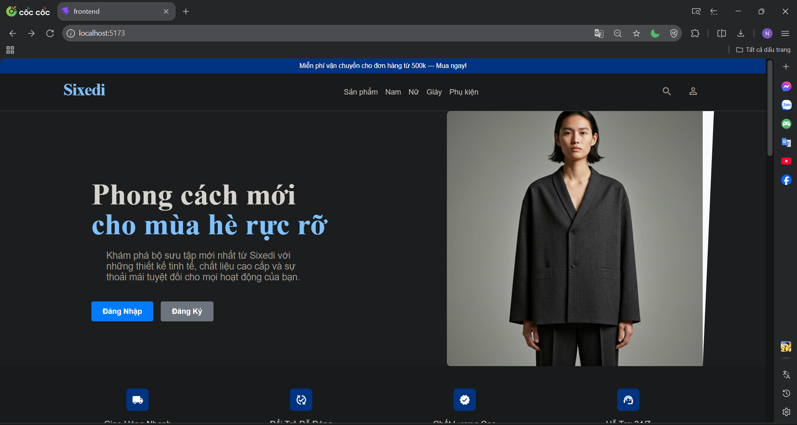
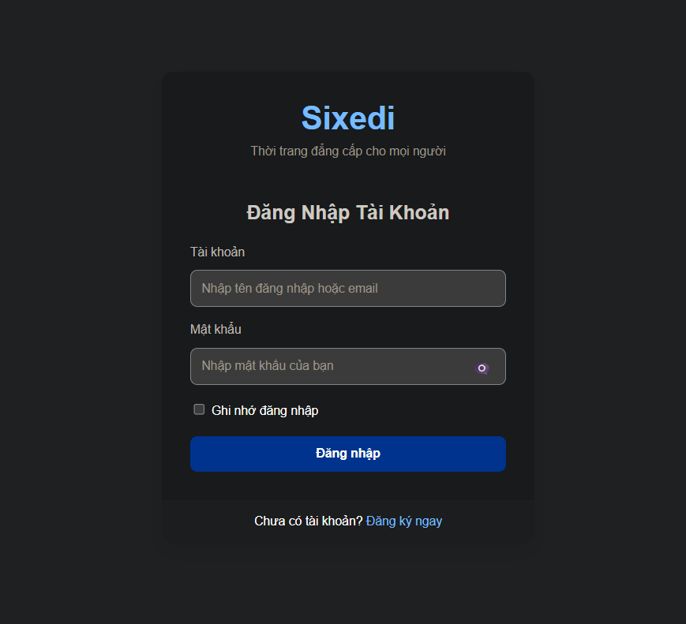
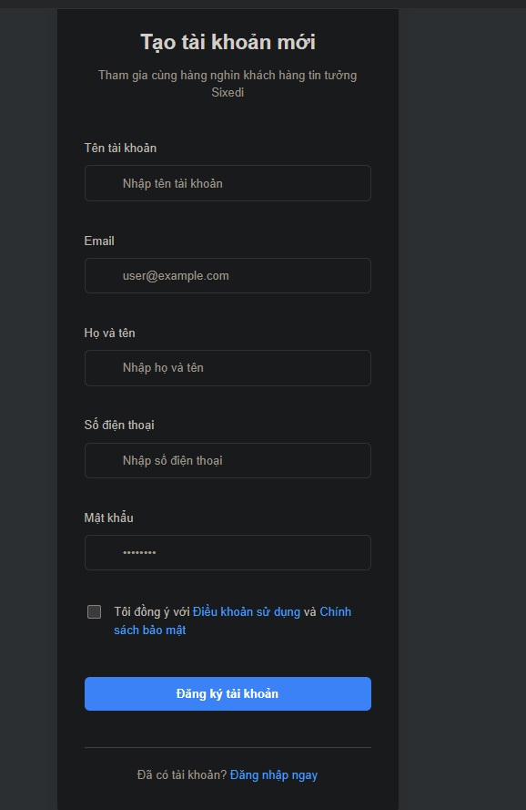
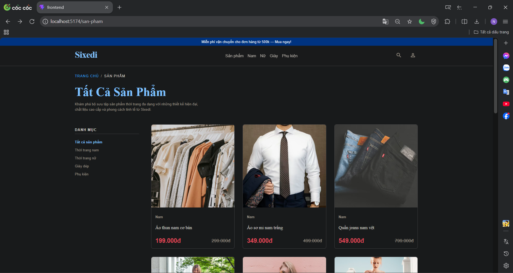
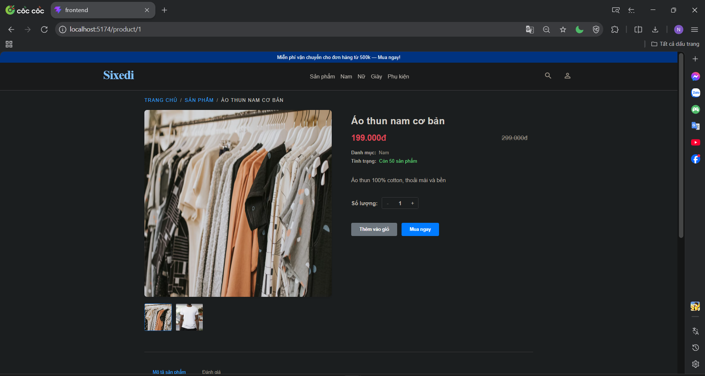
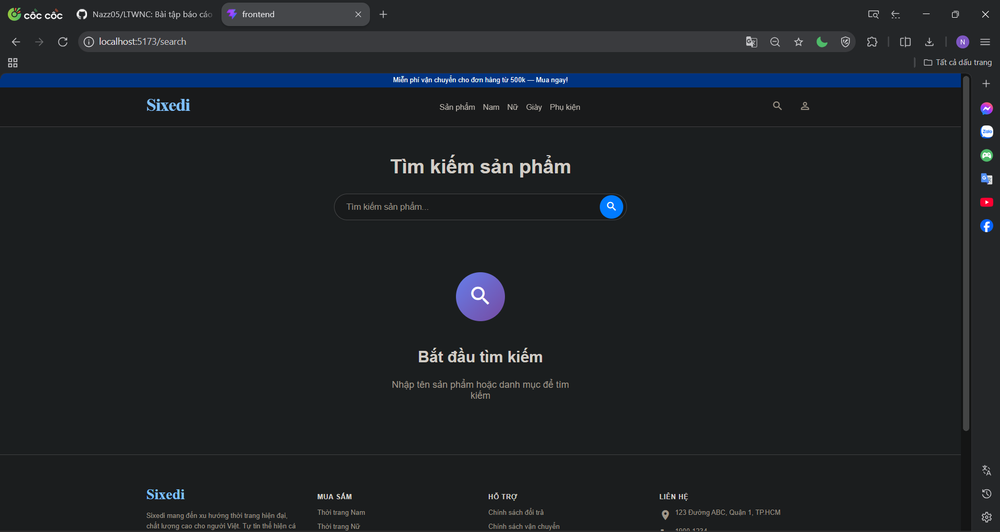
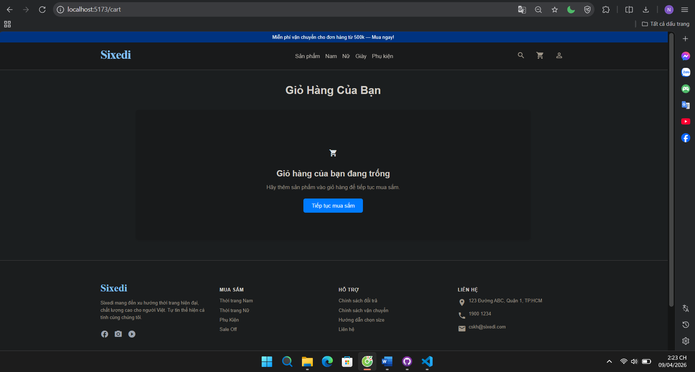
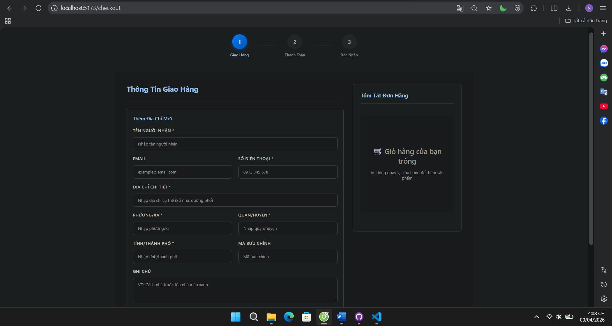

# Báo Cáo Tiến Độ Dự Án Frontend LTWNC Shop

## Kế Hoạch Triển Khai

Dự án được chia thành 8 giai đoạn chính với thời gian thực hiện dự kiến như sau:

### Giai Đoạn 1: Thiết Lập Nền Tảng (3/4/2026)

- Thiết lập cấu trúc project và môi trường phát triển
- Xây dựng layout cơ bản (header, footer, navigation)
- Cài đặt hệ thống routing cho ứng dụng

### Giai Đoạn 2: Phát Triển Trang Chủ

- Thiết kế và triển khai giao diện trang chủ
- Tích hợp hero section và danh mục sản phẩm
- Hiển thị sản phẩm nổi bật và khuyến mãi

### Giai Đoạn 3: Hệ Thống Xác Thực

- Phát triển form đăng nhập với validation
- Phát triển form đăng ký người dùng mới
- Thiết lập context quản lý trạng thái authentication

### Giai Đoạn 4: Quản Lý Dữ Liệu Sản Phẩm

- Tạo cơ sở dữ liệu sản phẩm dạng JSON
- Thiết lập cấu trúc dữ liệu chuẩn cho sản phẩm
- Chuẩn bị và tối ưu hình ảnh sản phẩm

### Giai Đoạn 5: Trang Danh Mục Sản Phẩm

- Xây dựng trang danh sách sản phẩm theo danh mục
- Triển khai chức năng lọc và sắp xếp sản phẩm
- Tích hợp phân trang (pagination) nếu cần thiết

### Giai Đoạn 6: Trang Chi Tiết Sản Phẩm

- Phát triển trang chi tiết sản phẩm với gallery ảnh
- Hiển thị thông tin chi tiết và biến thể sản phẩm
- Tích hợp chức năng thêm vào giỏ hàng

### Giai Đoạn 7: Tối Ưu UI/UX

- Cập nhật hình ảnh sản phẩm chất lượng cao
- Triển khai fallback cho hình ảnh
- Tối ưu responsive design và hiệu ứng animation

### Giai Đoạn 8: Kiểm Thử Và Triển Khai

- Thực hiện kiểm thử toàn diện các chức năng
- Sửa lỗi và tối ưu hiệu suất
- Chuẩn bị và thực hiện triển khai production

## Tiến Độ Thực Hiện

### Ngày 1 (3/4/2026)

- Thiết lập project và cấu trúc thư mục
- Tạo layout chính, header, footer
- Cài đặt routing cơ bản
- Xây dựng giao diện trang chủ với hero section, categories
- Hiển thị danh sách sản phẩm nổi bật
- Tạo form đăng nhập với validation
- Tạo form đăng ký với validation
- Thiết lập authentication context

#### Minh họa ngày 1

- Ảnh 1: Giao diện trang chủ và danh mục sản phẩm
- Ảnh 2: Form đăng nhập
- Ảnh 3: Form đăng ký

### Ngày 2 (8/4/2026)

- Tạo dữ liệu sản phẩm local (JSON)
- Thiết lập cấu trúc dữ liệu sản phẩm
- Import và chuẩn bị hình ảnh sản phẩm
- Xây dựng trang danh sách sản phẩm theo category
- Thêm chức năng lọc theo danh mục
- Xây dựng trang chi tiết sản phẩm
- Thêm gallery ảnh, thông tin sản phẩm

#### Minh họa ngày 2

- Ảnh 1: Giao diện trang sản phẩm
- Ảnh 2: Giao diện trang chi tiết sản phẩm
  
  

### Ngày 3 (9/4/2026)

- Thiết kế giao diện trang tìm kiếm
- Xây dựng layout trang tìm kiếm bao gồm thanh search, bộ lọc và vùng hiển thị kết quả
- Tối ưu trải nghiệm responsive cho mobile và desktop
- Chuẩn bị cấu trúc hiển thị danh sách sản phẩm tìm kiếm
- Phát triển trang giỏ hàng (Cart) với đầy đủ chức năng
- Hiển thị danh sách sản phẩm trong giỏ với hình ảnh, tên, giá, số lượng
- Tích hợp chức năng tăng/giảm số lượng, xóa sản phẩm
- Tính tổng tiền và hiển thị tóm tắt đơn hàng
- Cập nhật validation cho từng step
- Đảm bảo flow 3 bước: Giao Hàng → Thanh Toán → Xác Nhận

#### Minh họa ngày 3

- Giao diện trang tìm kiếm
  
- Giao diện giỏ hàng
  
- Giao diện Trang đặt hàng
  

### Ngày 4 (9/4/2026)

- Tham khảo dự án `web-client` để xây dựng trang quản lý thông tin tài khoản cho LTWNC
- Tạo route `/profile` và giao diện quản lý tài khoản thuần frontend
- Hiển thị form thông tin cá nhân với chức năng chỉnh sửa local UI
- Thêm các tab hiển thị Đơn hàng và Địa chỉ chỉ phục vụ mục đích giao diện, không gọi API
- Giữ nguyên thiết kế giống `web-client`, chỉ triển khai phần hiển thị thuần

#### Minh họa ngày 4

- Giao diện trang quản lý thông tin tài khoản
  
- Tab Đơn hàng
  
- Tab Địa chỉ giao hàng
  
